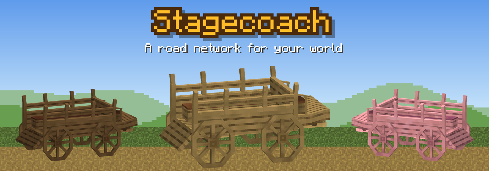
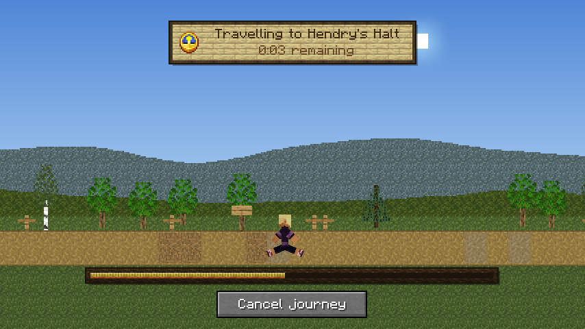
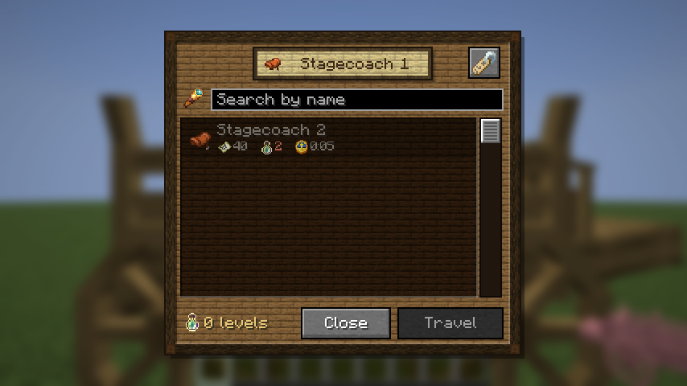

# Stagecoach

Placeable stagecoaches in eleven woods, and a road network between them, for Minecraft. Every village gets a coach
stop built from its own wood; players build the rest. Right-click a stop to discover it, pay a fare (XP levels, or
items), and ride the road to any stop you know. A journey takes time: you watch the road roll past and arrive in
front of the destination coach. The server checks every journey, and none is lost to a crash.

 

## Builds

| Minecraft | Fabric | NeoForge | Forge |
|---|---|---|---|
| 1.20.1 | ✓ | | ✓ |
| 1.21.1 | ✓ | ✓ | ✓ |
| 1.21.11 | ✓ | ✓ | ✓ |
| 26.2 | ✓ | ✓ | ✓ |
| 26.3 | ✓ | ✓ | ✓ |

Every build needs [GeckoLib](https://www.curseforge.com/minecraft/mc-mods/geckolib), and Fabric API on Fabric.
Install the same file on the server and every client. Downloads are on CurseForge.

There is also a [Paper plugin](paper/) for Paper 1.21.11 servers with unmodded players: the same coaches and
journeys, drawn through a resource pack the plugin serves itself.

## Documentation

**[felixforlyfe.github.io/Stagecoach](https://felixforlyfe.github.io/Stagecoach/)**

- [Player guide](https://felixforlyfe.github.io/Stagecoach/players/): crafting, placing, discovering and travelling,
  village stops, options, questions.
- [Pack developer guide](https://felixforlyfe.github.io/Stagecoach/pack/): settings, commands, permissions,
  structures and villages, travel rules, advancements, theming, export and import. No code needed.
- [Modder guide](https://felixforlyfe.github.io/Stagecoach/modders/): the Java API, events on every loader, and
  KubeJS.

## The repository

| Folder | What |
|---|---|
| `1.20.1/`, `1.21.1/`, `1.21.11/`, `26.2/`, `26.3/` | One Gradle project per Minecraft version: `common/` (shared code and every asset), and a thin `fabric/`, `neoforge/`, `forge/` layer each |
| `paper/` | The Paper plugin and its test tools |
| `tools/` | Python generators: collision from the model, structure injections, coach-stop pieces, events, changelogs, test structures |
| `docs/` | The documentation site |
| `specs/` | The design decisions for each release |
| `release/` | The store page, changelogs per file, logos and screenshots |

[CONTRIBUTING.md](CONTRIBUTING.md) explains how to build, test and change it.

## Licence

[MIT, with one condition](LICENSE): if you share Stagecoach or something built on it, credit the original author,
Feelix, and link to the original Stagecoach project. The author asks, as a wish rather than a rule, that modpacks and
addons point players to the original download instead of bundling copies.
